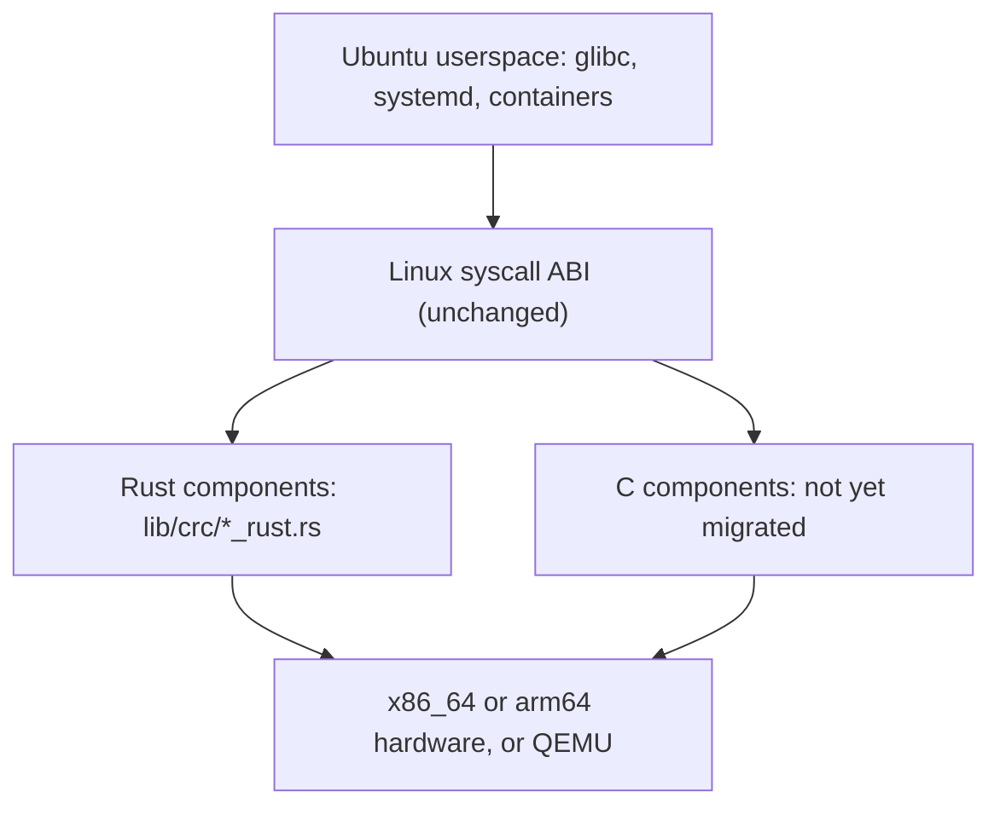

<p align="center">
  
</p>

<h3 align="center">Rewriting Linux in Rust, one subsystem at a time.</h3>

<p align="center">
  <a href="COPYING"></a>
  <a href="https://git.kernel.org/pub/scm/linux/kernel/git/stable/linux.git"></a>
  
  
</p>

---

Ferret is a **source-level fork of the real Linux kernel**. It keeps Linux's
architecture, Kbuild/Kconfig build system, licensing, provenance and userspace
ABI, and incrementally replaces C kernel components with native Rust
implementations.

The Rust code is not a wrapper around C. A migrated component is the
implementation the kernel links and executes: the C object is removed from the
build, the exported symbols are provided by Rust, and the replacement is
validated with differential tests and a real boot.

**Ferret is experimental and very early.** Two small library components have
been replaced. This is not a usable kernel replacement, and it is nowhere near
"Linux, rewritten in Rust". It is a reproducible method for getting there.

## Status

Measured, not estimated. `VERIFIED` means the evidence is in the repository.

| Milestone | State |
| --- | --- |
| Upstream reference kernel (`v6.18.57`) builds and boots | **VERIFIED** |
| Native Rust components linked into a real kernel | **VERIFIED** — CRC-16, CRC-CCITT |
| x86_64 kernel build | **VERIFIED** |
| x86_64 QEMU boot with Rust components active | **VERIFIED** |
| Differential tests: C reference vs Rust implementation | **VERIFIED** |
| Kernel linkage proof (C object absent, symbol ownership, export type) | **VERIFIED** |
| arm64 kernel build and QEMU boot | **VERIFIED** |
| Ubuntu 24.04 userspace: shell and systemd | **VERIFIED** — amd64 and arm64 |
| Container / Docker userspace | **NOT TESTED** |
| Physical hardware boot | **NOT TESTED** |
| Runtime performance comparison | **NOT TESTED** (QEMU TCG only) |

The authoritative, machine-readable source of truth is
[`registry/migrations.json`](registry/migrations.json); the rendered report is
[`docs/ferret/REGISTRY_REPORT.md`](docs/ferret/REGISTRY_REPORT.md), and the
sanitized verification evidence of the last clean cycle is in
[`docs/ferret/evidence/`](docs/ferret/evidence/).

There is deliberately no "percent of Linux rewritten" figure. Two utilities do
not make a percentage of a 30-million-line kernel.

## How Ferret works

Ferret adds a Rust implementation next to the C original, selects it with a
Kconfig switch, removes the C object from the build, and proves the link and
the behaviour. The C source stays in the tree as the reference used by the
differential tests until the Rust component has been validated and reviewed.



* **What "migrated" means:** the C translation unit is not compiled, the Rust
  object defines the ABI symbols, the exported symbol keeps its exact
  visibility, and differential plus boot tests pass.
* **What it does not mean:** a Rust driver that calls into C, or a wrapper
  around the original implementation.

Read [the architecture document](docs/ferret/ARCHITECTURE.md) for the full
design: userspace boundary, MM, scheduler, VFS, networking, security,
architecture support, and the Rust/C transition rules.

## Can I run it?

Yes — in QEMU, in about the time it takes to build a kernel.

**Linux** (tested: Ubuntu 24.04, clang/lld 18, rustc 1.88, QEMU 8.2):

```sh
git clone https://github.com/overlordxrz-source/ferret.git
cd ferret

# 1. Build the reference kernel (unmodified upstream) and the Ferret kernel
tools/ferret/build.sh ref
tools/ferret/build.sh rust

# 2. Boot both; the script checks KUnit and userspace markers
tools/ferret/boot.sh ref
tools/ferret/boot.sh rust

# 3. Symbol ownership / linkage evidence
tools/ferret/linkage.sh rust
```

**macOS / Apple Silicon**: the same commands run against the project's
containerized toolchain (`tools/ferret/docker/`), which cross-builds x86_64 and
builds arm64 natively. The container is the only supported macOS path; the host
OS and boot configuration are never modified.

Full instructions, pinned toolchain versions and the reproducibility story:
[`docs/ferret/BUILDING.md`](docs/ferret/BUILDING.md).

## Contributing

> **Pick a component. Rewrite it in Rust. Prove it works. Submit a PR.**

The migration is designed as a set of independently reviewable engineering
puzzles — [the Ferret Migration Map](https://github.com/overlordxrz-source/ferret/issues?q=is%3Aissue+label%3A%22type%3Amigration%22),
described in [`docs/ferret/MIGRATION_MAP.md`](docs/ferret/MIGRATION_MAP.md).
Each issue states the C file, the symbols, the tests, the safety invariants and
the acceptance criteria. If you want to work on one, comment on the issue to
claim it; a maintainer will acknowledge it and mark it `status: claimed`.

Start with the [contributor guide](CONTRIBUTING.md) and the
[porting policy](docs/ferret/PORTING_POLICY.md). `good first issue` and
`difficulty: starter` labels are kept accurate — if an issue says starter, a
focused patch really is enough.

## Roadmap

| Workstream | State |
| --- | --- |
| 0. Build infrastructure and reproducible testing | **active** — container, QEMU, registry, CI |
| 1. Kernel libraries and algorithms | **active** — CRC-16, CRC-CCITT migrated |
| 2. Rust kernel interfaces and ownership primitives | next — `kfifo`, per-CPU and file-operations prerequisites |
| 3. Drivers and device infrastructure | planned |
| 4. Filesystems and VFS | planned |
| 5. Memory management | planned |
| 6. Processes and scheduling | planned |
| 7. Networking | planned |
| 8. Security and isolation | planned |
| 9. Architecture-specific code | x86_64 primary, arm64 second lane |
| 10. Complete userspace compatibility and hardware coverage | long-term |
| 11. Elimination of transitional C implementations | continuous |

The full plan, including exit criteria per phase, is in
[`docs/ferret/ROADMAP.md`](docs/ferret/ROADMAP.md).

## License and provenance

Ferret is a fork of the Linux kernel and is distributed under the
**GNU General Public License, version 2 only** (`GPL-2.0-only`), like the
upstream kernel. Every file keeps its original SPDX identifier and copyright
notices; new Ferret files are GPL-2.0-only unless stated otherwise.

* Upstream: [Linux kernel](https://www.kernel.org/), stable tree
  `git.kernel.org/pub/scm/linux/kernel/git/stable/linux.git`
* Pinned baseline: tag `v6.18.57`, commit
  `2ff600d29ee478d0a8d46ef8a58afb5e038fe692`
* Ferret builds on [Rust for Linux](https://rust-for-linux.com/) and the
  in-tree `kernel` crate; it is not affiliated with or endorsed by the Linux
  Foundation, the upstream Linux maintainers, or the Rust for Linux project.

See [`docs/ferret/UPSTREAM.md`](docs/ferret/UPSTREAM.md) for the exact
provenance, synchronization workflow and licensing obligations.
