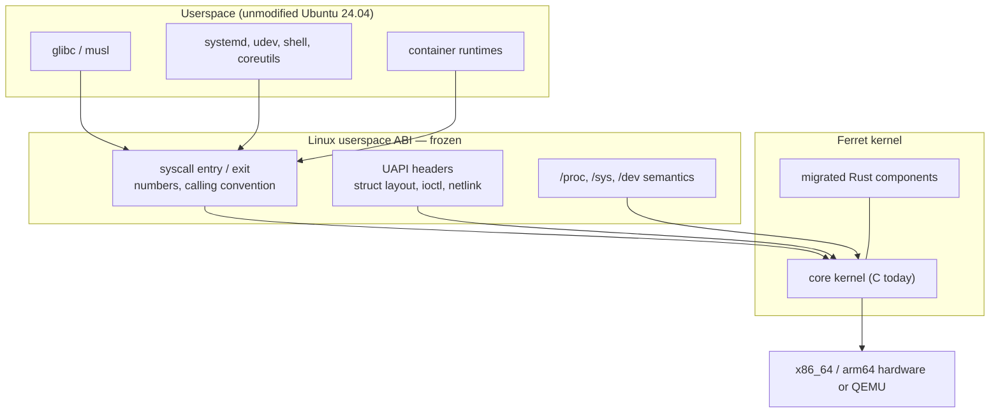
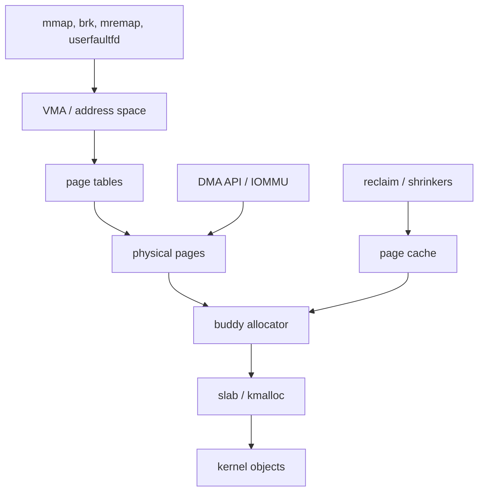
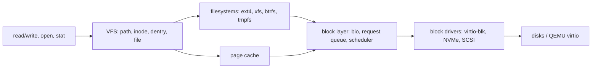
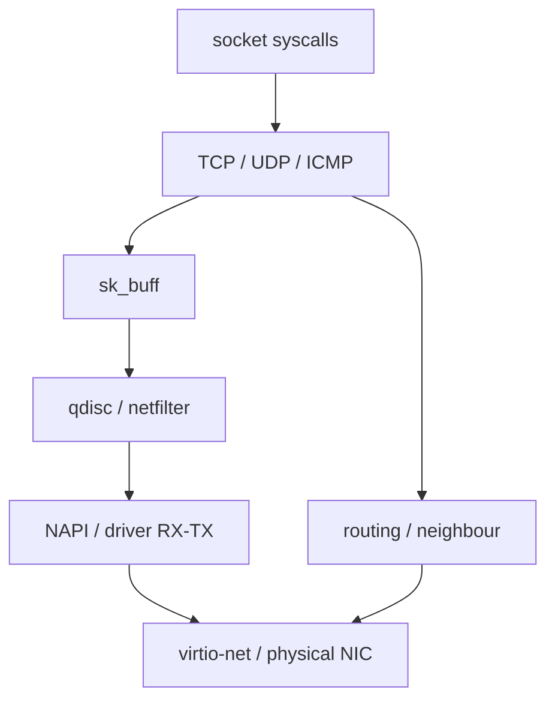
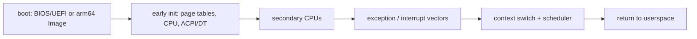
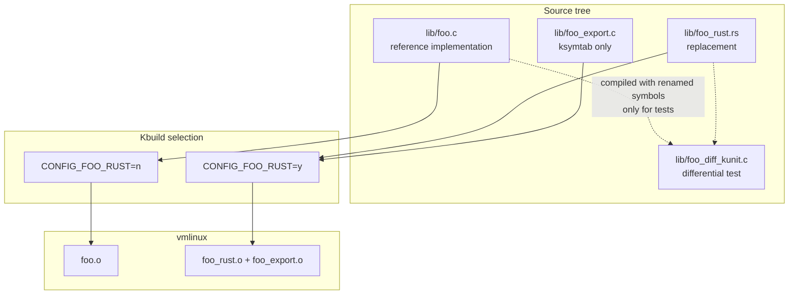
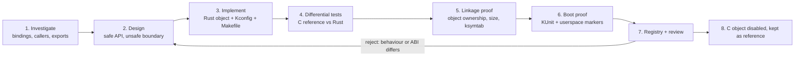
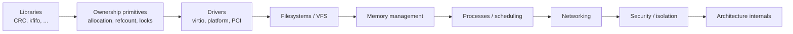

# Ferret architecture

This document describes *how* Ferret migrates Linux from C to Rust. It is the
contract that every migration must follow.

## 1. Principles

1. **The fork is Linux.** Ferret keeps the upstream directory layout, Kbuild,
   Kconfig, licensing, ABI and architecture. There is no parallel build system,
   no "ferret kernel" framework replacing upstream facilities.
2. **One component at a time.** A migration unit is the smallest component with
   a stable, narrow C interface (a function family, not a subsystem). CRC-16 is
   the first unit; see `MIGRATION_MATRIX.md`.
3. **The Rust code is the implementation.** A migration is only "complete" when
   the C implementation is not compiled into the kernel, the Rust code defines
   the ABI symbol, and the kernel exercises the Rust code at runtime. Wrapping
   the C function in Rust is explicitly not a migration.
4. **The C original is retained until proven.** The reference implementation is
   never deleted in the same commit that introduces the Rust replacement. It is
   compiled into the differential test instead.
5. **Behaviour and ABI are preserved exactly** — including error behaviour,
   boundary values, symbol visibility (`EXPORT_SYMBOL` vs `EXPORT_SYMBOL_GPL`)
   and calling conventions.
6. **Safety is localised.** Safe Rust is the default; `unsafe` blocks carry
   `// SAFETY:` comments stating the invariant and who upholds it. Raw pointers
   are confined to the FFI boundary.

## 2. Migration layers

```
        userspace ABI (unchanged)
                  |
   +--------------+----------------------------------------------+
   |  C call sites (unchanged headers: include/linux/<comp>.h)   |
   +--------------+----------------------------------------------+
                  |  exact C ABI (extern "C")
   +--------------+----------------------------------------------+
   |  Rust implementation (lib/<subsys>/<comp>_rust.rs)          |
   |  - #[export] -> #[no_mangle] + bindgen signature check      |
   |  - safe inner functions, unsafe only at the FFI boundary    |
   +--------------+----------------------------------------------+
                  |  Kbuild: obj-$(CONFIG_...) += <comp>_rust.o
   +--------------+----------------------------------------------+
   |  ksymtab glue (linkage metadata only)                       |
   +-------------------------------------------------------------+
```

### 2.1 Selecting the implementation

Each migration adds a `bool` Kconfig symbol next to the existing `tristate`:

```kconfig
config CRC16
	tristate            # upstream, unchanged

config CRC16_RUST
	bool "Rust implementation of CRC-16 (Ferret)"
	depends on RUST
	select CRC16        # CRC16 has no prompt; select forces = y
```

The `select` is not cosmetic: a promptless upstream `tristate` (as both `CRC16`
and `CRC_CCITT` are) is only ever enabled by other symbols, so `depends on
CRC16 = y` silently yields nothing on a defconfig where the only selector is a
module. DECISIONS D-015 records the arm64 failure this caused.

Constraints:

* The upstream config symbol keeps its type and semantics, so `select CRC16`
  from drivers keeps working.
* The Rust variant is only selectable when the component is built-in (`= y`).
  A Rust implementation cannot currently be a loadable module in Ferret.
* The C variant remains the default until the Rust variant has full test
  evidence; flipping the default is a separate, reviewed decision.

### 2.2 Makefile pattern

```make
ifeq ($(CONFIG_CRC16_RUST),y)
obj-y += crc16_rust.o crc16_export.o
else
obj-$(CONFIG_CRC16) += crc16.o
endif
```

The C object is *not built at all* for the Rust variant, which makes duplicate
definitions impossible and makes the "is the C code gone?" question answerable
from the build directory (`lib/crc/crc16.o` must not exist).

### 2.3 Rust-to-C interface

* The Rust function signature is the C signature, verified at compile time by
  the upstream `#[export]` attribute. `#[export]` compares the function item
  type against the bindgen-generated declaration `kernel::bindings::<name>`
  (all branches of an `if` must have the same type), then applies `#[no_mangle]`.
* The C declaration stays in the original upstream header
  (`include/linux/crc16.h`), which is what bindgen reads. No new ABI header is
  invented.
* The component's header is added to `rust/bindings/bindings_helper.h` so that
  bindgen emits the prototype used for the signature check.

### 2.4 Symbol visibility

Upstream CRC-16 is `EXPORT_SYMBOL(crc16)` (not GPL-only). The Rust `#[export]`
facility in 6.18 exports symbols through `rust/exports.c` only for the `kernel`
crate, and it uses `EXPORT_SYMBOL_RUST_GPL`, i.e. GPL-only. Using it would
silently change the ABI for non-GPL modules, which is not acceptable.

Therefore each migrated component keeps a *linkage-only* C file (e.g.
`lib/crc/crc16_export.c`) whose entire content is:

```c
extern u16 crc16(u16 crc, const u8 *p, size_t len);
EXPORT_SYMBOL(crc16);
```

This file contains no algorithm and no fallback: if the Rust implementation is
missing, the link fails. It exists solely to emit an `__ksymtab_crc16` entry
with the original visibility. It is tracked in the registry as a remaining C
dependency with the exit condition "upstream Rust support for per-symbol
`EXPORT_SYMBOL` from non-`kernel`-crate objects" (see `DECISIONS.md` D-004).

## 3. Testing architecture

Every migration is validated on four independent levels:

1. **Compile/link evidence** — the C object is absent, the Rust object is
   present, the symbol is defined once, and the ksymtab entry exists.
2. **Upstream KUnit** — upstream's own suite must pass unchanged
   (`CONFIG_CRC_KUNIT_TEST` compares `crc16()` against an independent
   bit-at-a-time reference implementation, including randomised buffers, guard
   pages and interrupt-context execution).
3. **Differential KUnit** — a test-only build of the *original C file*, symbol
   renamed with `-Dcrc16=crc16_c_ref`, is compared against the Rust
   implementation over edge cases and randomised inputs.
4. **Boot evidence** — the kernel boots in QEMU, runs all built-in KUnit suites,
   and the freestanding Rust init (`tools/ferret/init`) exercises the userspace
   ABI (uname, mount, openat/read/close, reboot) and powers the machine off.

Test results are classified PASS / FAIL / SKIP / NOT RUN. A build is never
reported as a boot, and a boot without the expected markers is FAIL.

## 4. Rust code style in the kernel

* `#![no_std]`; no allocator unless the component needs one.
* Table-driven algorithms use `const` tables (compile-time, in `.rodata`), not
  lazily initialised statics, so behaviour is unchanged on early boot.
* Loops keep the C implementation's iteration order and arithmetic widths;
  index expressions use `usize` casts explicitly.
* No `panic!` paths in code reachable through the exported ABI. A panic in
  kernel Rust aborts the kernel, so bounds are proven by construction (a
  `u8`-indexed 256-entry table cannot be out of bounds).
* KUnit tests live next to the implementation behind `#[cfg(CONFIG_KUNIT)]`.

## 5. Long-term subsystem architecture

Design targets for the large subsystems are in `docs/ferret/design/`:

| Document | Scope |
| --- | --- |
| `design/mm.md` | page allocator, slab, VMAs, page tables, reclaim, page cache |
| `design/sched.md` | task lifecycle, runqueues, preemption, SMP, context switch |
| `design/vfs.md` | inodes, dentries, file descriptors, page cache integration, filesystems |
| `design/net.md` | packet representation, sockets, TCP/IP, routing, driver interfaces |
| `design/security.md` | credentials, capabilities, namespaces, cgroups, LSM |
| `design/arch.md` | boot, exceptions/interrupts, low-level CPU, assembly boundary |
| `design/dependencies.md` | migration order and C-interface reduction plan |

These are targets, not commitments to implement immediately. The ordering
principle is that each migration must *reduce* the C surface a later migration
depends on.

## 6. System architecture

This section describes the whole system Ferret is aiming at, and separates what
exists today from what is planned. Nothing below is a claim that a subsystem has
been ported.

**Implemented in Ferret today:** the build/test infrastructure, and two library
components (CRC-16, CRC-CCITT) whose Rust objects replace the C object in the
active build. Everything else is upstream Linux C, upstream Rust for Linux
infrastructure, or future work.

### 6.1 Userspace boundary and the ABI

Ferret does not define a new userspace interface. A migrated component must be
invisible to userspace: same syscalls, same numbers, same struct layouts, same
`errno` values, same ioctl numbers, same `/proc` and `/sys` surfaces.



Compatibility goals, in order:

1. **glibc** — the primary target; validated by booting a real Ubuntu root
   filesystem to a shell and to `systemd` as PID 1.
2. **musl** — planned; no musl userspace has been booted yet.
3. **systemd and containers** — systemd as PID 1 is verified on both
   architectures; container runtimes are not tested.
4. **32-bit compatibility** — `CONFIG_COMPAT` paths must keep working; not yet
   exercised by the test harness.

A migration may not change a UAPI structure, a syscall semantic, or an exported
symbol's linkage. The review checklist for this is in
[ABI_COMPATIBILITY.md](ABI_COMPATIBILITY.md).

### 6.2 Core kernel

Processes, threads, the scheduler, signals, timekeeping, interrupts and
synchronisation are the load-bearing C core. They are **not** migrated, and they
are where the ownership model is hardest: task lifetime is reference-counted and
RCU-protected, and the scheduler runs with preemption disabled on per-CPU state.

| Area | Today | Rust target |
| --- | --- | --- |
| Task/thread lifecycle | C (`kernel/fork.c`) | reference-counted task handle; no Rust-owned `task_struct` |
| Scheduler | C (`kernel/sched/`) | out of scope until ownership primitives exist |
| Signals | C (`kernel/signal.c`) | scoped helpers only, after task handles |
| Timekeeping | C (`kernel/time/`) | leaf algorithms first (e.g. conversion helpers) |
| Interrupts | C + asm (`kernel/irq/`, `arch/*/`) | Rust handlers only via existing Rust for Linux IRQ abstractions |
| Synchronisation | C primitives + Rust wrappers | use `kernel::sync` wrappers; never re-implement locking |

The rule for this layer: a Rust component may only exist where the kernel crate
already gives a sound ownership story (a pinned `Arc`, a `Guard`, a
`ScopedBarrier`, an IRQ registration). Otherwise the prerequisite is a reviewed
abstraction, not an `unsafe` shortcut.

### 6.3 Memory management



The allocator is a C core with per-CPU caches, zone watermarks and reclaim
callbacks. The Rust abstractions that exist (`KBox`, `KVBox`, `Vec`, `Arc`)
delegate to `kmalloc`/`kvmalloc` and carry fallible allocation.

Ferret's position: **no memory-manager migration until the ownership and
allocation interface workstream lands.** A Rust page allocator that cannot
describe reclaim, migration and DMA lifetimes would be a toy, and replacing it
early would make every later migration unsound. The near-term work is an
inventory of allocation sites and the invariants the C API expects
(see `ROADMAP.md`, workstream 2).

### 6.4 Storage and filesystems



VFS object lifetimes are the central difficulty: dentries and inodes are
reference-counted, RCU-walked and locked in defined orders, and a `struct file`
can outlive the process that opened it. A safe Rust rewrite needs a
lifetime-encoded dentry/inode handle and a way to express "this pointer is valid
under RCU read lock". Ferret does not have that yet.

Near-term, realistic work is at the edges: a filesystem's pure in-memory
algorithms, checksum/CRC users (already migrated), and small VFS helpers with
narrow contracts. The Ubuntu ext4 root filesystem used by the test harness runs
on the C implementation.

### 6.5 Networking



`sk_buff` is the hardest data structure in the kernel to express in Rust: it has
headroom/tailroom, paged fragments, clones with shared data, destructors and
per-CPU caches. Ferret's plan is to start with bounded, pure pieces
(checksums, parsers, lookup tables) and only then attempt a packet
representation.

Networking is exercised in the Ubuntu boots (virtio-net is present and
configured by systemd), but the harness does not yet assert end-to-end
connectivity.

### 6.6 Device ecosystem

| Area | Status | Rust path |
| --- | --- | --- |
| Device model / driver core | C | Rust abstractions exist upstream (`kernel::device`, `kernel::driver`) |
| PCI | C | `kernel::pci` exists upstream; no Ferret driver uses it yet |
| USB | C | upstream Rust abstractions are partial |
| Storage drivers | C | virtio-blk in C; not migrated |
| GPU / DRM | C | no Rust DRM abstraction; out of scope near-term |
| Network devices | C | no Ferret net driver |

Driver migration is the most natural long-term fit for Rust (bounded, hot-plug
lifecycle, DMA ownership), but it needs the device/driver abstractions to be
complete for the specific bus. The first candidate will be chosen from an
actual upstream Rust driver abstraction (`kernel::platform`, `kernel::pci`)
rather than invented.

### 6.7 Security and isolation

Credentials, capabilities, namespaces, cgroups, seccomp and LSMs are C. Rust
does not by itself make these safe: the trust boundary is between kernel and
userspace, and a logic bug in a capability check is a privilege escalation
regardless of the language.

Ferret's contribution here is the **Rust/C trust boundary**:

* every `unsafe` block is a documented assumption about C-owned memory;
* a Rust component may not weaken an exported symbol's visibility (a GPL-only
  change is an ABI regression);
* no Rust wrapper may silently fall back to C on error;
* security-relevant migrations require a second reviewer (label
  `needs: safety review`).

The reporting process is in [SECURITY.md](../../SECURITY.md).

### 6.8 Architecture support



Ferret keeps both architecture ports:

* **x86_64** — the primary lane; reference and Rust kernels built and booted.
* **arm64** — a maintained second lane; built natively in the aarch64 build
  container and booted under `qemu-system-aarch64 -M virt`.

Architecture-specific assembly (entry, context switch, exception vectors) stays
C/asm. Any Rust in this area must go through the upstream Rust for Linux arch
support and is reviewed as expert-level work.

### 6.9 Transitional Rust/C integration



The transition has four obligations:

1. **Ownership translation.** C callers pass raw pointers with implicit
   lifetime rules; the Rust side must convert them at the boundary and encode
   the rule in a type or a `// SAFETY:` comment.
2. **Allocation failure.** C returns `NULL` or `-ENOMEM`; Rust must not panic
   and must preserve the original failure behaviour, including in atomic or
   IRQ context where the C code used `GFP_ATOMIC`/`GFP_NOWAIT`.
3. **Refcounting.** `kref`/`refcount_t` semantics (including "no increment on
   zero") must be preserved; Rust `Arc` is only usable when the object is
   already Rust-allocated.
4. **Locking.** Rust must use the kernel's lock types and lock ordering, not a
   Rust mutex abstraction of its own. Sleeping locks cannot be used in atomic
   context, and the type system does not know that unless the wrapper does.

Exit criteria for the transition are tracked in `ROADMAP.md`, workstream 11:
a component stops being transitional when the C file is removed from the tree,
not merely from the build.

### 6.10 Porting and verification pipeline



A component only reaches step 8 with all evidence recorded. The harness treats a
missing step as `NOT RUN`, never as a pass.

### 6.11 Migration roadmap



The stages overlap in practice; the ordering constraint is dependency-driven,
not cosmetic. The verified position is at the start of stage 1; the registry is
the source of truth for what has actually moved.

## 7. What is explicitly not claimed

* Ferret is not a working replacement for Linux as a product.
* The Ubuntu compatibility demonstrated so far is: boot to a shell and boot to
  `systemd` multi-user, on x86_64 and arm64, under QEMU. It is not a desktop,
  not a network stack validation, and not hardware support.
* No performance claims are made. All measurements so far are under QEMU TCG.
* Upstream Rust for Linux abstractions are used where they exist; Ferret does
  not claim authorship of them.
